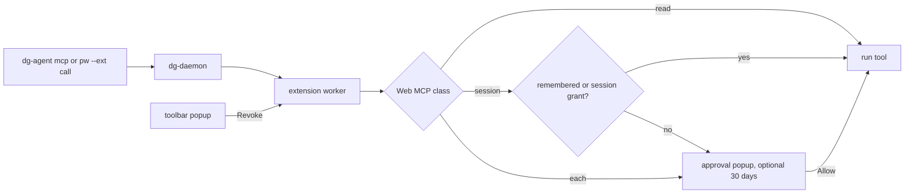

# 0046 — Web MCP approvals apart from pw --ext browser control

Status: Proposed
Date: 2026-11-13

## Context

- Web MCP `dg_` tool calls run through the pw --ext `call` verb
  ([ADR 0035](0035-pw-ext-real-browser.md)). They inherited the pw --ext
  controls of [ADR 0045](0045-pw-ext-driving-banner-and-sites.md): the site
  allowlist gated them, and Stop dropped their grants.
- Web MCP session grants were keyed by session, origin, tool and tab group. A
  grant given in one tab group did not hold in another tab of the same site.
- The person could not see or revoke a Web MCP grant apart from a pw --ext Stop.
- Spec 018 R-13 (2026-11-13): Web MCP and browser control with pw --ext are
  two separate things. R-14 (2026-11-13): Web MCP approvals offer an optional
  30-day grant that the person can revoke.
- A site tool without a `dg_` name had no Web MCP approval at all. The site
  allowlist was its only gate.

## Decision

Web MCP has its own approvals only. `tools` and `call` skip the pw --ext site
question (`NO_SITE_ASK` in `pkg/extension/lib/background/pw-ext.ts`). Before a
call, `requestWebMcpApproval` in
`pkg/extension/lib/background/webmcp-approval.ts` applies the tool's class:
`read` runs, `session` asks once per MCP session, site and tool, and `each`
asks every time. A tool with no `dg_` name is now `each`. The site is the
registrable-domain key of `siteOf` in
`pkg/extension/lib/background/site-key.ts`; no tab group is part of the key. A
`session` approval popup offers an unticked "Remember for 30 days" checkbox.
When the person ticks it, the worker stores the site and tool, the approval
time, the expiry time and a random nonce in `storage.local`, with an HMAC from
the non-extractable key of `pkg/extension/lib/background/webmcp-signing.ts` over
a `webmcp-grant:v1` payload. The live nonces sit in the extension origin's
IndexedDB (`pkg/extension/lib/background/webmcp-grant-nonces.ts`), each with
its site and tool; Revoke deletes every nonce of that site and tool there, so it
does not depend on the `storage.local` list. A remembered grant holds for every session until it expires
or its nonce goes; use does not extend it. pw --ext Stop no longer drops Web MCP grants.
Session grants still end with the dg session (`forgetAgentTabs` in
`pkg/extension/lib/background/daemon-link.ts`). The toolbar popup
(`pkg/extension/lib/features/popup.ts`) lists session and remembered grants
with Revoke and Revoke all. The worker answers those messages only from the
extension's own `popup.html` (`isOwnPageSender`).

## Consequences

- **Good:** one Allow for a `session` tool covers every agent tab of that site
  in the session, and the person can keep it for 30 days.
- **Good:** the person sees each Web MCP grant and can revoke it without
  stopping browser control.
- **Good:** a site's own WebMCP tool now asks every time; before, one site
  Allow let it run with no further question.
- **Bad:** a `read` `dg_` tool, such as `dg_outlook_read`, now runs with no
  question at all, also when an agent tab reached the site by a link or a
  redirect and no site question was asked. The person's consent is enabling the
  built-in script. The `area` class of R-10 is the planned seam for a per-area
  ask.
- **Bad:** `tools` asks nothing, so the agent can read the tool list, title and
  URL of any page its tab reaches. The mailbox filter still applies.
- **Bad:** a remembered grant covers every agent session for 30 days. A content
  script can read or delete the record in `storage.local`, but it cannot forge
  or extend one without the key, and it cannot write back a revoked one, because
  its nonce is gone from IndexedDB.
- **Neutral:** after Stop the session's tabs return to the person and every
  verb fails, so its Web MCP grants stay but have no tab to run in until the
  session ends.
- **Neutral:** the HMAC key is shared with script approvals. The
  `webmcp-grant:v1` prefix keeps a grant MAC apart from a script MAC, which
  signs a JSON array.

## Amended 2026-11-14: Web MCP on the person's own tabs

R-13 of spec 018 says Web MCP and pw --ext browser control are separate. This
amendment takes that to the tabs too: `dg-agent mcp` no longer needs a pw --ext
session or an agent tab group.

- Two new relay verbs, `webmcp-tools` and `webmcp-call`
  (`PW_EXT_WEBMCP_VERBS` in `pkg/common/src/pw-ext-format.ts`), carry no tab
  id. The extension advertises them in its connect handshake, and the daemon
  refuses them with the update message when an older extension does not list
  them. They are not `dg-skills pw --ext` verbs.
- The extension scans the person's open tabs whose origin an enabled built-in
  script or a third-party script that the browser runs covers (only an
  approved script with a valid signature is registered,
  `runningThirdPartyMatches` in
  `pkg/extension/lib/background/webmcp-scripts.ts`) (`webMcpTabs` in
  `pkg/extension/lib/background/pw-ext.ts`). It skips private-window,
  discarded and browser-page tabs, reads at most 20 tabs and lists at most 100
  tools by count and by a byte budget, and asks the tabs at the same time.
  Held pw --ext secrets of the session stay masked. An `http://localhost`
  or `http://127.0.0.1` script pattern now covers that host on any port in
  `matchesCoverOrigin`. It reads only
  `dg_` tools; on a mailbox tab only those of an enabled built-in that covers
  it (R-7).
- A call goes to the first tab that exposes the tool: the active tab of the
  focused window, then the most recently used tab. The extension never opens,
  focuses, moves or groups a tab, adds no banner or dialog shim, and asks no
  pw --ext site question.
- After pw --ext Stop of a dg session, these verbs refuse that session. Stop
  drops the session's held secrets, so the extension could no longer mask
  them in tool output. The Web MCP grants stay, as before.
- The approval classes stay the only gate. The popup also names the tab title,
  masked on mail sites with the same rule as `pw --ext tabs`.
- The session of a `session` grant is the paired dg session that `dg-agent mcp`
  runs in, the relay `sessionId`. It ends with that session, as before.
- The list returns tool names and descriptions only, not tab titles or
  addresses.
- `pw --ext tools` and `call` still run in the agent's own tab group inside a
  pw --ext session, and every other pw --ext verb on a tab outside that group
  is still refused.

Consequences:

- **Good:** an agent can use the `dg_` tools of a signed-in tab the person
  already has open, with no agent tab group and no driving banner.
- **Bad:** the extension now runs a MAIN-world tool listing in the person's
  covered tabs on each list and call. Only tabs of a script the person enabled
  or approved are touched.
- **Neutral:** page-registered `dg_` tools on a site that no enabled or approved
  script covers are not listed. Turning that on means a script run in every
  open tab.

## Alternatives considered

- **Keep the site allowlist as a second gate for Web MCP.** R-13 rejects it:
  the two features must not depend on each other.
- **Remember `each` tools too.** R-14 rejects it: send, delete and other
  high-risk tools always ask.
- **Store remembered grants unsigned.** Content scripts can write
  `storage.local`, so an unsigned record could be forged.
- **Sign the record with no nonce.** A content script could save a signed record
  and write it back after a Revoke.

## Diagrams

## References

- `pkg/extension/lib/background/webmcp-approval.ts`
- `pkg/extension/lib/background/webmcp-grant-nonces.ts`
- `pkg/extension/lib/background/pw-ext.ts`
- `pkg/extension/lib/background/approval.ts`
- `pkg/extension/lib/background/daemon-link.ts`
- `pkg/extension/lib/features/popup.ts`
- `pkg/extension/entrypoints/approve/main.ts`

## Amended 2026-11-14: area grants (ADR 0047)

[ADR 0047](0047-webmcp-area-approval-class.md) adds the `area` class. An area
grant uses the same `{site, tool}` record with the synthetic tool key
`area:<area>`. One `mail` grant covers list and search on a site, and reading
a message body needs its own `mail-body` grant. The `read` class has no tool
left.
