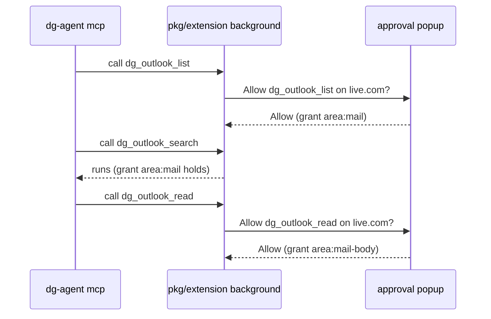

# 0047 — Web MCP area approval class

Status: Proposed
Date: 2026-11-14

## Context

- [ADR 0046](0046-webmcp-approvals-apart-from-pw-ext.md) keys a Web MCP grant
  by session, site and tool. The `read` class ran mail list, search and read
  with no question.
- Spec 018 R-10 (2026-11-13): reading mail is an approval area. The tools of
  an area ask once per session, site and area. This amends R-3.
- The user rule: opening message bodies, contacts or calendar needs a
  permission prompt, asked once per session where the class allows.
- Dante's answer on PR #208 (2026-11-14): reading a message body gets its own
  approval. List and search do not cover it.

## Decision

`WebMcpApprovalClass` gets `area`. `WEBMCP_TOOL_AREAS` in
`pkg/common/src/webmcp-format.ts` gives `dg_outlook_list` and
`dg_outlook_search` the area `mail`, and `dg_outlook_read` the area
`mail-body`. `requestWebMcpApproval` in
`pkg/extension/lib/background/webmcp-approval.ts` stores an area grant under
the synthetic tool key `area:<area>`, in the same `{site, tool}` record. Real
tool names must match `dg_...`, so the key cannot collide with a tool. The
session store, the signed 30-day remembered store (R-14) and the revoke
messages therefore do not change. An area-class tool with no known area asks
every time. The prompt says what the area covers, and the popup and Options
revoke lists name the area.

## Consequences

- **Good:** one prompt covers mail list and search on a site for the session,
  and a second prompt guards message bodies.
- **Good:** the grant record shape and its HMAC payload stay the same, so the
  remembered grants and revoke paths of ADR 0046 work as they are.
- **Bad:** an agent that reads many bodies on a site needs the mail-body Allow,
  which is one more prompt than one shared mail area.
- **Neutral:** the `read` class has no tool left. It stays for a future tool
  that reads nothing private.

## Alternatives considered

- **An `area` field on the grant record.** It changes the HMAC payload, the
  revoke messages and the popup parser for no gain over a key that cannot
  collide with a `dg_` name.
- **One mail area for list, search and read.** Dante rejected it on PR #208: a
  list approval must not also open full bodies for 30 days.
- **Keep list and search `read`.** R-10 rejects it: mail metadata is mail
  content too.

## Diagrams

## References

- `pkg/common/src/webmcp-format.ts`
- `pkg/extension/lib/background/webmcp-approval.ts`
- `pkg/extension/lib/features/webmcp-grants.ts`
- `.agents/spec/018_web_mcp_plugins/plan.md` R-10, R-14
