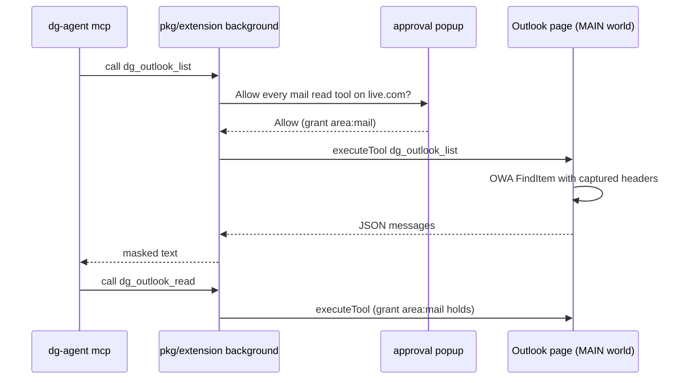

# 0047 — Web MCP area approval class and the Outlook mail tools

Status: Proposed
Date: 2026-11-14

## Context

- [ADR 0046](0046-webmcp-approvals-apart-from-pw-ext.md) keys a Web MCP grant
  by session, site and tool. The `read` class ran mail list, search and read
  with no question.
- Spec 018 R-10 (2026-11-13): reading mail is one approval area. Mail list,
  search and bodies ask once per session, site and area, and contacts and
  calendar are their own areas. This amends R-3.
- The user rule: opening message bodies, contacts or calendar needs a
  permission prompt, asked once per session where the class allows.
- The Outlook built-in pointed at `content-scripts/webmcp-outlook-main.js`,
  which no build shipped. On an Outlook tab, pw --ext could read and click
  the page like any other site.
- The spike (`.agents/references/webmcp-outlook-spike.md` on
  `spike/webmcp-outlook`) picks OWA service calls for all ten mail commands.
  The DOM list is virtualized, and a DOM read can mark a message read.

## Decision

`WebMcpApprovalClass` gets `area`. `WEBMCP_TOOL_AREAS` in
`pkg/common/src/webmcp-format.ts` gives `dg_outlook_list`, `dg_outlook_search`
and `dg_outlook_read` the area `mail`. `requestWebMcpApproval` in
`pkg/extension/lib/background/webmcp-approval.ts` stores an area grant under
the synthetic tool key `area:<area>`, in the same `{site, tool}` record. The
session store, the signed 30-day remembered store and the revoke messages
therefore do not change. An area-class tool with no known area asks every
time. `mailbox()` in `pkg/extension/lib/background/tab-guards.ts` now covers
the Outlook hosts, so on an Outlook tab only enabled built-in `dg_outlook_`
calls pass. The runtime-registered content script
`pkg/extension/entrypoints/webmcp-outlook-main.content.ts` runs
`pkg/extension/lib/features/webmcp-outlook/`. That code holds the header
observer, the OWA service client (4 calls in flight at most) and the ten
tools.

## Consequences

- **Good:** one prompt covers all mail reading on a site for the session, and
  no tool reads subjects, previews or bodies without that prompt.
- **Good:** the grant record shape and its HMAC payload stay the same, so the
  remembered grants and revoke paths of ADR 0046 work as they are.
- **Bad:** an agent that gets approval for list can also read full bodies on
  that site with no second prompt, for 30 days when remember is ticked.
- **Bad:** Outlook tabs show no title or address in pw --ext, and the popup
  cannot hand an open Outlook tab to an agent. The agent opens one with
  `pw --ext new`.
- **Neutral:** every OWA request and response shape is inferred from the spike.
  The R-11 throwaway-item capture must confirm it before the built-in is on by
  default.

## Alternatives considered

- **An `area` field on the grant record.** It changes the HMAC payload, the
  revoke messages and the popup parser for no gain over a key that cannot
  collide with a `dg_` name.
- **Keep list and search `read`.** R-10 rejects it: subjects and previews are
  mail content too.
- **DOM automation.** The spike shows a virtualized list that renders only in a
  front tab, and a read that changes the read state.

## Diagrams

## References

- `pkg/common/src/webmcp-format.ts`
- `pkg/extension/lib/background/webmcp-approval.ts`
- `pkg/extension/lib/background/tab-guards.ts`
- `pkg/extension/lib/features/webmcp-outlook/`
- `pkg/extension/entrypoints/webmcp-outlook-main.content.ts`
- `.agents/spec/018_web_mcp_plugins/plan.md` R-10, R-11, R-14
