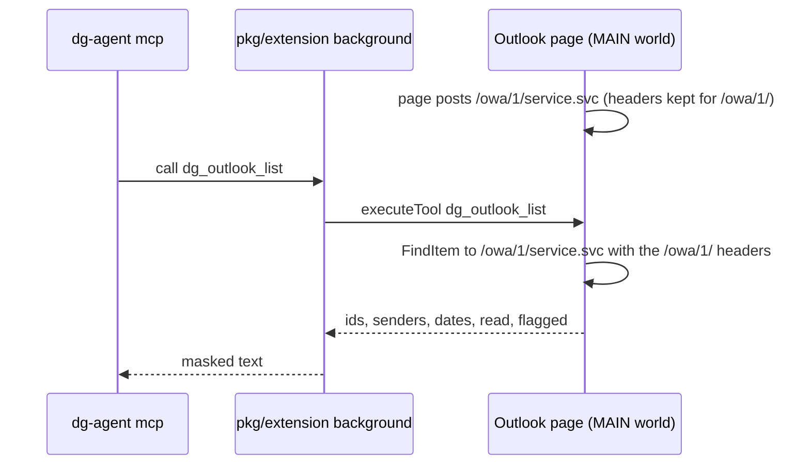

# 0048 — Outlook mail Web MCP tools over OWA service calls

Status: Proposed
Date: 2026-11-14

## Context

- The Outlook built-in pointed at `content-scripts/webmcp-outlook-main.js`,
  which no build shipped. On an Outlook tab, pw --ext could read and click
  the page like any other site.
- The spike (`.agents/references/webmcp-outlook-spike.md` on
  `spike/webmcp-outlook`) picks OWA service calls for all ten mail commands.
  The DOM list is virtualized, and a DOM read can mark a message read.
- [ADR 0047](0047-webmcp-area-approval-class.md) puts list and search in the
  `mail` area and reading a body in the `mail-body` area.
- Dante's answers on PR #208 (2026-11-14): list and search mask subject and
  preview; Outlook tabs stay mailbox tabs; tool errors reach the agent; the
  built-in stays off by default.

## Decision

The runtime-registered content script
`pkg/extension/entrypoints/webmcp-outlook-main.content.ts` runs
`pkg/extension/lib/features/webmcp-outlook/`:

- **Observer.** A header tap keeps the OWA session headers of same-origin
  `service.svc` requests in the page closure, one copy per endpoint path
  (`/owa/<n>/service.svc`). An anchor change drops only that endpoint's copy.
- **Service.** Each call posts to the endpoint of the tab's own account: the
  `/mail/<n>/` index of the page, or `/owa/0/` on `outlook.live.com` and
  `/owa/service.svc` elsewhere when the page has no index. It sends only the
  headers held for that endpoint, so one account's headers never reach another
  account's endpoint. At most 4 calls are in flight per tab, and a queued call
  whose signal aborted is never sent. A call fails only when no response
  message succeeded.
- **Tools.** List and search return id, sender address, date, read and flag
  state, and never ask Outlook for the subject or the preview. Read returns the
  subject and the plain-text body. A write tool on several ids returns the ids
  that worked and a code-only error per id that failed.
- **Mailbox tabs.** `mailbox()` in `pkg/extension/lib/background/tab-guards.ts`
  covers the Outlook hosts. On an Outlook tab only enabled built-in
  `dg_outlook_` calls pass, and their errors reach the agent through
  `maskRaw`. Agents open Outlook with `pw --ext new`; the popup refuses to add
  an open Outlook tab.

## Consequences

- **Good:** no tool shows a subject, preview or body without a prompt, and
  bodies need their own prompt.
- **Good:** a batch move with one stale id still moves the other items and
  tells the agent which id failed.
- **Bad:** Outlook tabs show no title or address in pw --ext, and the popup
  cannot hand an open Outlook tab to an agent.
- **Bad:** search can still match on subject text, so an agent can learn
  whether a word is in a subject from the match count.
- **Neutral:** every OWA request and response shape, and the `/mail/<n>/` to
  `/owa/<n>/` mapping, is inferred from the spike. The R-11 throwaway-item
  capture must confirm them before the built-in is on by default.

## Alternatives considered

- **DOM automation.** The spike shows a virtualized list that renders only in a
  front tab, and a read that changes the read state.
- **One header copy per page.** A second signed-in account could send its
  headers to the first account's endpoint.
- **Fail a whole batch on the first bad id.** The items that moved get new ids
  that the agent then never sees.

## Diagrams

## References

- `pkg/extension/lib/features/webmcp-outlook/`
- `pkg/extension/lib/features/request-header-tap.ts`
- `pkg/extension/lib/background/tab-guards.ts`
- `pkg/extension/entrypoints/webmcp-outlook-main.content.ts`
- `.agents/spec/018_web_mcp_plugins/plan.md` R-9, R-11
