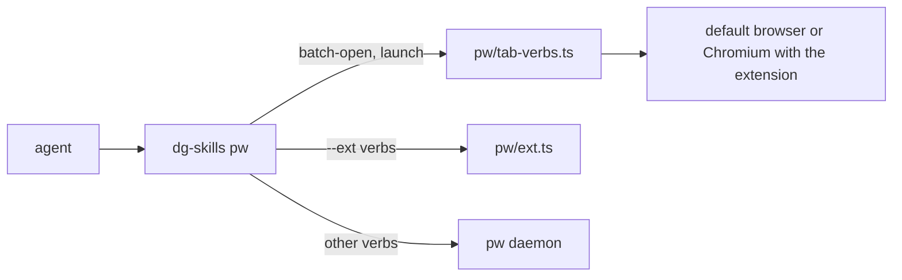

# 0049 — Fold browser skill into pw

Status: Accepted
Date: 2026-11-19

## Context

- `/dg:browser` was a thin skill over top-level `dg-skills batch-open` and
  `dg-skills launch`. It held no logic of its own.
- `/dg:pw` already drives the person's real browser with `pw --ext` tab verbs,
  so two skills covered tab work in the same browser.
- Callers such as `/dg:pushup`, `/dg:land`, `/dg:sdlc` and `/dg:deps-upgrade`
  linked the browser skill only to explain one command.
- [ADR 0028](0028-local-default-extension-opt-in.md) made plain `batch-open`
  local by default and kept `launch` `--ext`-only. That rule stays.

## Decision

`batch-open` and `launch` are pw verbs. `pkg/skills-cli/src/pw/cli.ts` routes
them to `pkg/skills-cli/src/pw/tab-verbs.ts` before the `--ext` relay branch, so
`pw --ext launch` and `pw batch-open --ext` reach the tab verbs. The verbs keep
their options and reuse `runBatchOpen` and `runLaunch`. A CLI-only install
refuses `pw launch` and `pw batch-open --ext`. The top-level commands are gone
with no aliases, and the browser skill is deleted. Its detail moves to
`plugins/dg/skills/pw/references/tabs.md`. `dg-skills install` stays top-level,
and demo and rerun stay with `/dg:demo`. A skills-only install prunes a stale
`browser` skill whose SKILL.md matches a shipped dg copy.

## Consequences

- **Good:** one skill owns tab work, and callers name one command,
  `dg-skills pw batch-open`.
- **Good:** the doctor items `batch-open` and `launch` keep their ids and now
  check the pw skill files and the pw allow rule.
- **Bad:** scripts that call `dg-skills batch-open` or `dg-skills launch` fail
  with an unknown command error and must add `pw`.
- **Neutral:** the completion tree lists both verbs under `pw`.

## Alternatives considered

- **Keep aliases for one release.** Dante chose a clean removal; every caller
  is in this repository and changes in the same PR.
- **Keep the browser skill as a pointer to pw.** It would keep a second entry
  point for the same commands.

## Diagrams

## References

- `pkg/skills-cli/src/pw/cli.ts`
- `pkg/skills-cli/src/pw/tab-verbs.ts`
- `pkg/common/src/node/install-skills.ts`
- `plugins/dg/skills/pw/references/tabs.md`
- [0028 — Run every skill locally and make the extension opt-in with `--ext`](0028-local-default-extension-opt-in.md)
