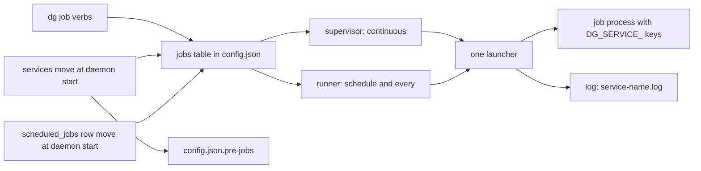

# One job model for services and scheduled jobs

Status: Accepted
Date: 2026-11-19
Topic: Platform

## Context

- The daemon ran two kinds of command under two nouns. A service was a long-running program in the `services` table of
  the config file. A scheduled job was a row in the `scheduled_jobs` table of the encrypted database.
- The two kinds had two command groups (`dg-daemon service` and `dg-daemon job`), two launch paths and two sets of rules
  for the environment, the log and the timeout.
- A user who wanted the review bot repository to run its `bot` and `bot-dev` processes had to learn both nouns, and a
  scheduled job got none of the `DG_SERVICE_*` keys of [ADR 0043](0043-outside-services.md).
- A scheduled job wrote its stderr to a database column, not to a log file that a user can read.
- The start at login of [ADR 0020](0020-one-dg-command.md) needs one verb that turns a job on and offers the login unit.

## Decision

dg has one noun, the job. A job is one entry in the `jobs` table of the daemon config file, and it has exactly one of
the three mode keys: `continuous`, `schedule` (a `cron` expression) or `every` (an interval). `dg job` runs `dg-daemon
job`, and its verbs are `add`, `update`, `remove`, `enable`, `disable`, `start`, `stop`, `restart`, `list`, `status` and
`logs`. `enable` and `disable` change the stored `enabled` state and act now; `start`, `stop` and `restart` act now
only.

One launcher (`pkg/dg-daemon/src/jobs/launcher.ts`) starts each run of each mode with the same environment: the
allowlist, `passEnv`, `envFile`, the injected keys, the state folder and the grant keys. The supervisor runs a
continuous job. The runner runs a scheduled job at each tick and reads the `jobs` table to find it. `JobControl`
(`pkg/dg-daemon/src/jobs/control.ts`) gives the service API routes one surface for the two modes.

The run rules of the two modes differ. For a continuous job, a continuous job that exits with 0 stops, and each other
exit starts it again with a backoff of 1 s to 60 s. For a scheduled job, a scheduled job gets no second try after a
failure; a run that overlaps the next scheduled time is skipped; and one catch-up run follows downtime. The limits of a
scheduled run: an explicit `--timeout` is not clamped; with no `--timeout`, a run with `--feed` has the 30 s limit and
the 256 KB output limit, and a run with no `--feed` has no default limit. A job with `--feed` prints one JSON object for
each item; a job with no `--feed` writes its output to its log.

Two migrations run at each daemon start, under the config lock, in `cmdServe`. The first moves each `services` entry to
the `jobs` table and keeps the copy `config.json.pre-jobs` of the config file, with mode 0600. The second moves each `scheduled_jobs`
row to the `jobs` table in three steps: it saves the chosen name in the row, writes the config file one time, then sets
`moved_at` and rewrites the argv of the row as the encrypted text `[]`. That last step runs with `PRAGMA
secure_delete=ON`, then `PRAGMA wal_checkpoint(TRUNCATE)`, so the old ciphertext leaves the free pages and the WAL. Only
the row move writes `jobsVersion: 2`. A label that is not a valid name gets a new name, and the daemon logs `scheduled
job "<old>" is now "<new>"`; `dg job list` shows `was "<old>"`.

The old forms stay as aliases until the next major release: `--label` for `--name`, `--cron` for `--schedule`,
`--pass-env` for `--env`, `job rm` for `job remove`, and `job run` and `job exec` for `job start`. The `dg-daemon
service` group also stays until then. An `add` with `--label` or `--cron` writes an enabled job with `feed: true`, as
before. The log path `<log>/service-<name>.log` and the pid path `<state>/daemon/services/<name>.pid` do not move, and
the service API names keep the word `SERVICE` (`DG_SERVICE_API`, `DG_SERVICE_LABEL`, `DG_SERVICE_STATE_DIR`).

The login unit rules: `dg-daemon autostart` installs, removes and reports the login unit. The first `dg job enable` at a
terminal asks one time to install the login unit, and dg keeps each answer. `enable` with no terminal only prints the
hint. The jobs skill does not answer the login unit question of `job enable`.

## Consequences

- **Good:** one noun, one table and one launcher. A scheduled job gets the `DG_SERVICE_*` keys, `envFile` and `passEnv`,
  and its stderr goes to its log file (`pkg/dg-daemon/src/jobs/launcher.ts`).
- **Good:** `dg job list` shows continuous and scheduled jobs in one list (`pkg/dg-daemon/src/commands/jobs.ts`).
- **Bad:** the move has one cost: the argv of a scheduled job is now plain text in a config file with mode 0600, and no
  longer encrypted text in the database. After a good row move, the daemon removes the snapshot
  `pre-migration-v14-*.db` that it wrote before the schema change, with its `-wal`, `-shm` and `-journal` files,
  because that snapshot holds the old encrypted argv (`pkg/dg-daemon/src/jobs/migrate.ts`).
- **Bad:** `dg job start` of a scheduled job, and the alias `run`, need a live daemon. On the release before, `job run`
  worked with no daemon.
- **Bad:** a scheduled run has no pid file guard, so a run that stays alive after a SIGKILL of the daemon can overlap
  the next run.
- **Bad:** there is no database rollback, because the release before refuses the database after the row move, and the
  snapshot from before is gone. The owner can still copy `config.json.pre-jobs` back to restore the config file from
  before.
- **Neutral:** when a daemon of the release before still runs, a `dg job` verb that writes waits 10 s at most, then
  stops with the `not migrated` text and the pid of that daemon. The owner runs `dg daemon restart`, and dg never
  restarts that daemon itself.
- **Neutral:** the `cwd`, `interval_ms`, `cron_expr`, `enabled` and `notify_identity` columns of a moved row stay in the
  database and are not read again.

## Other options

- **Two nouns with a shared launcher.** It keeps two command groups and two tables for one idea.
- **Scheduled jobs in the database, services in the config file.** A user then reads two stores to see what the daemon
  runs.
- **Keep the argv encrypted in the database.** The `jobs` table is the one source of a job, and a split entry has two
  writers.
- **A retry for a failed scheduled run.** A poll that fails again at once adds load, and the next scheduled time is the
  retry.
- **One catch-up run for each missed time.** After a long downtime it starts many runs at once with the same input.

## Diagram

## References

- `pkg/dg-daemon/src/jobs/config.ts`
- `pkg/dg-daemon/src/jobs/launcher.ts`
- `pkg/dg-daemon/src/jobs/runner.ts`
- `pkg/dg-daemon/src/jobs/control.ts`
- `pkg/dg-daemon/src/jobs/migrate.ts`
- `pkg/dg-daemon/src/store/index.ts`
- `pkg/dg-daemon/src/commands/jobs.ts`
- `pkg/dg-daemon/src/commands/job-support.ts`
- [docs/jobs-and-services.md](../jobs-and-services.md)
- [ADR 0043](0043-outside-services.md) and [ADR 0020](0020-one-dg-command.md)
