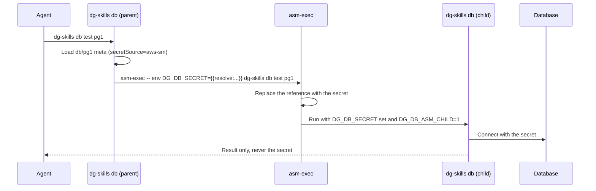

# aws-sm db secrets resolve only through an asm-exec re-run of the CLI

Status: Accepted
Date: 2026-11-20
Topic: Security

## Context

- `dg-skills db setup --secret aws` lets a database password stay in AWS Secrets Manager.
- An agent runs the db commands. If the CLI read the secret itself, the value could reach the agent's chat, logs or shell history.
- The house rule forbids `get-secret-value` and the Secrets Manager Agent daemon. It asks for `{{resolve:secretsmanager:...}}` references run through `asm-exec`.
- `asm-exec` swaps those references only inside the command's arguments. It does not touch the environment it gets.

## Decision

The stored `db/<name>` credential keeps only a reference: `secretSource=aws-sm`, the secret id, the JSON key, and an optional AWS profile and region. Its value is a placeholder, not the password.

When a db command opens such a connection, the CLI does not connect. It starts the same command again under `asm-exec`. The new command line is `asm-exec -- env DG_DB_SECRET=<placeholder> dg-skills db <verb> ...`. Because the placeholder is an argument, `asm-exec` replaces it with the real value. Then `env` puts that value in the child's environment. The parent also sets `DG_DB_ASM_CHILD=1`, so the child knows to read `DG_DB_SECRET` as its password.

Only `pkg/skills-cli/src/db/aws-secret.ts` knows about `asm-exec` and the placeholder. When `asm-exec` is missing, the command stops with an install hint. It never falls back to another way to read the secret.

## Consequences

- The password exists only inside the `asm-exec` process and the child db command. The parent and the agent never see it.
- A connection with a secret in AWS needs `asm-exec` from the Agent Toolkit for AWS `aws-core` plugin on the machine.
- Each db command on such a connection starts one extra process.
- For a moment the value sits in the command line of `env`. Another process of the same user could see it there.
- Tests use a fake `asm-exec`, so the live path needs a machine that has the real one.

## Diagram

## Other options

- Read the secret in the CLI with the AWS SDK `GetSecretValue`. This breaks the house rule, and the value would live in the agent-run process.
- Pass the placeholder in an environment variable to `asm-exec`. It does not work, because `asm-exec` replaces references only in arguments.
- Copy the secret into the local credential store at setup. This puts a second copy on disk and ages out when the secret rotates.

## References

- [pkg/skills-cli/src/db/aws-secret.ts](../../pkg/skills-cli/src/db/aws-secret.ts)
- [pkg/skills-cli/src/db/credentials.ts](../../pkg/skills-cli/src/db/credentials.ts)
- [pkg/skills-cli/__tests__/db-aws-secret.spec.ts](../../pkg/skills-cli/__tests__/db-aws-secret.spec.ts)
- [AWS: Use secrets safely with AI Coding Agents](https://docs.aws.amazon.com/secretsmanager/latest/userguide/retrieving-secrets-ai-agents.html)
- [ADR 0006](0006-credential-store.md)
