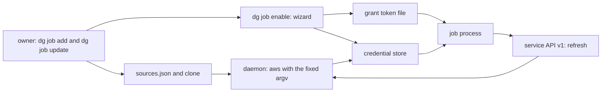

# Job sources and credentials

Status: Accepted
Date: 2026-11-20
Topic: Platform

## Context

- [ADR 0049](0049-jobs.md) gave dg one job model, but an owner still wrote each job by hand: the command, the folder, the
  environment file and the credentials. A repository that ships a job, such as the review bot repository with its `bot` and
  `bot-dev` processes, had no way to say what it needs.
- [ADR 0043](0043-outside-services.md) gave a job a credential grant. The owner made it with `dg-agent start` and
  `dg-skills credentials grant`, and a job could only read a credential: it could not ask for a new one.
- A job that runs code from a repository runs with the rights of the user. The owner must see what the repository asks for
  before dg writes anything, and must see it again when the repository changes.
- A credential often lives in a secret store already. The owner should not paste it again, and a job should be able to ask for
  a new copy when its upstream refuses the old one.

## Decision

A job comes from one of two source kinds. A repository (`dg job add <git-url>[@ref]`) is cloned to `<data>/jobs/<source>/`
and pinned to a full commit id. `add` prints the request and asks for consent at a terminal, or takes `--yes`. A local path
(`dg job add <path>`) has no pin and no question: a file becomes one job with a record of kind `path`, and a folder with a
`dg` block becomes block jobs. The registry of both kinds is `<data>/jobs/sources.json`. The owner runs `git` and the build
in the CLI process; the daemon runs no `git` command.

A repository or a folder declares its jobs in the `dg` key of `package.json`: `jobs`, `credentials`, `requires` and `build`.
dg sets `cwd`, `grant`, `enabled`, `passEnv` and `credentialEnv` itself, so a block cannot. A relative `envFile` resolves
below the state folder of the job. The `credentials` of a job list names; the details of a name hold `prompt`, `required`,
`meta`, `source` and `env`. The one source type of this release is `aws-secretsmanager`, with `secretId`, `region`, `key` and
`profile`. A credential bound to an environment variable with `env` or with `--credential <name>=<NAME>` is required at
launch, and a block with `env` on a credential with `required: false` is refused.

dg makes the credential prefix from the source name, and the name of a file job is its own prefix. The names `pw`,
`extension`, `phone-friend`, `phone-vault` and `db` are reserved, and the prefix `pw` is also sealed. A prefix that already
holds credentials needs one adoption question at a terminal: `This job can read these credentials. Continue? [y/N]`. Only an
answer at a terminal passes it, also for an agent, and `setup --rotate-token` and `setup --refresh` follow the same rule.

`update` of a repository job fetches the recorded origin, resolves the stored ref and shows the change. An unchanged block
asks `Update to this commit? [y/N]`, a changed block prints the full request and asks `Apply these changes? [y/N]`, and with
no terminal and no `--yes` it refuses. `update` replaces the repository keys, keeps `enabled` and `passEnv`, names each
replaced key, and refuses while a job of the source is `running` or in `backoff`. A new credential gets no question: `update`
prints `next: dg job setup <name>`.

The owner writes credentials through one route, `POST /jobs/<name>/credentials`, which takes the owner token. Its operations
are `status`, `set`, `delete`, `ensure-grant` and `rotate-grant`, all below the credential prefix of that one job, and none
returns a value. The route adds no authority: the owner token already lists each session token. `ensure-grant` makes the grant
of the prefix when none is valid and leaves a valid one alone.

`dg job enable <name>` runs a wizard for a job that lists credentials. For each credential it takes the value from the
declared source, from a hidden prompt, or from `--setup`. `--setup` takes a file path or `-` for stdin and never JSON text,
because a command line is visible to other processes, and it refuses a file that other users can read. The wizard stores the
values, makes the grant with `ensure-grant`, then starts the job. `dg job setup <name>` changes a credential later,
`--rotate-token` makes a new token, and `--refresh` fetches each credential that has a source again with the shell of the
owner.

Service API v1 gets one new operation, `refresh`, with the body keys `operation`, `name` and `job`. This record adds it to v1,
as [ADR 0043](0043-outside-services.md) allows for an addition. The daemon starts an `aws` process only for `refresh`, with the
fixed argv of the declared source, and it reads `<data>/jobs/sources.json` only for that operation. The request cannot give a
secret id, a region, a key, a profile or an argv. `refresh` answers 409 unless a person ran `dg job setup <name>` once and the
record key equals the grant of the job. The fetch uses the recorded profile and the environment of the named job. It allows
one fetch for one credential in 60 s, and dg starts no refresh on its own. After a 502 the next step is
`dg job setup <job> --refresh`.

A job reads a credential in two ways: through service API v1 with its grant, or as an environment variable that the launcher
sets at every start. The child and its children see that variable.

## Consequences

- **Good:** a repository describes its jobs and credentials, and the owner sees the request before dg writes a file
  (`pkg/dg-daemon/src/commands/job-source.ts`).
- **Good:** an owner enters each credential once, from the secret store or a hidden prompt, and a job asks for a new copy
  with no person present (`pkg/dg-daemon/src/jobs/credential-refresh.ts`).
- **Good:** the daemon starts no `git` process and reads the registry for one operation only.
- **Bad:** `--yes` has a cost: a process that can run `dg job add <url> --yes` can run the code of that repository with no
  question.
- **Bad:** a local job needs no consent, and a repository can name an AWS secret. The request text shows the secret.
- **Bad:** the owner token can write the credentials of a job. A grant is not a sandbox, and one job of a source can read the
  credentials of the other jobs of that source.
- **Bad:** `setupDone` is not reset by `update`, so a changed source that `update --yes` applies can be refreshed with no
  person present.
- **Bad:** `refresh` is not a sandbox against a running job: its `envFile` can set `PATH` or `AWS_*` for the `aws` process.
- **Neutral:** the service API names keep the word `SERVICE`, and a refreshed value reaches an environment variable at the
  next start of the job.

## Diagram

## Other options

- **Run `git` in the daemon.** The daemon would run code from a network on a timer, with no person at a terminal.
- **Let a request name the source.** A job could then fetch any secret that the profile reaches. The record of the owner is
  the one source of the argv.
- **Ask no adoption question.** A new job could read credentials that another tool stored under the same prefix.
- **Take `--setup` as JSON text.** A secret on a command line is visible to every process of the machine.
- **Refresh on a timer.** dg would fetch with no failure and no person to see it.

## References

- `pkg/dg-daemon/src/jobs/declaration.ts`
- `pkg/dg-daemon/src/jobs/sources.ts`
- `pkg/dg-daemon/src/jobs/setup-answers.ts`
- `pkg/dg-daemon/src/jobs/secret-sources.ts`
- `pkg/dg-daemon/src/jobs/credential-refresh.ts`
- `pkg/dg-daemon/src/jobs/launcher.ts`
- `pkg/dg-daemon/src/commands/job-source.ts`
- `pkg/dg-daemon/src/commands/job-update.ts`
- `pkg/dg-daemon/src/commands/job-local.ts`
- `pkg/dg-daemon/src/commands/job-setup.ts`
- `pkg/dg-daemon/src/server/job-credentials.ts`
- `pkg/dg-daemon/src/server/service-api.ts`
- `pkg/common/src/credentials-format.ts`
- `pkg/common/src/node/job-credentials-client.ts`
- [docs/jobs-and-services.md](../jobs-and-services.md)
- [docs/service-api.md](../service-api.md)
- [ADR 0049](0049-jobs.md) and [ADR 0043](0043-outside-services.md)
