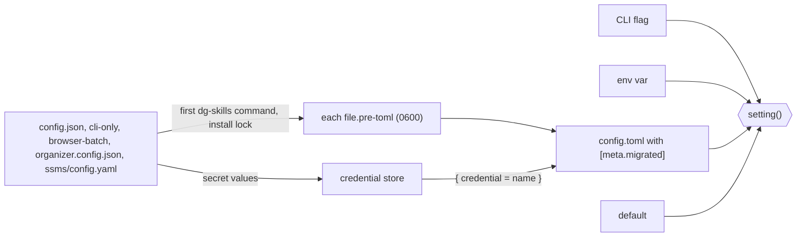

# One config.toml for dg

Status: Accepted
Date: 2026-11-21
Topic: Platform

## Context

- dg kept its settings in many files: `config.json` (hooks only), a `cli-only` marker, `~/.config/browser-batch/config.json`
  (ref aliases), the inbox `organizer.config.json` and `ssms/config.yaml`. Each had its own reader, its own format and its own
  precedence, and the inbox file could hold a client secret in plain text.
- [ADR 0025](0025-per-os-layout.md) put every dg file under `resolveDgPaths`, so one config file can live in the config folder
  and follow `XDG_CONFIG_HOME`, `DG_HOME` and `DG_PATH_FENCE` like every other path.
- [ADR 0006](0006-credential-store.md) gave dg an encrypted credential store. A config file that holds secrets cannot be read,
  copied or shared safely.

## Decision

dg keeps its settings in one file, `config.toml`, at `resolveDgPaths().configTomlPath`: `<configDir>/config.toml`. That is
`~/.config/dg/config.toml` on Linux (`$XDG_CONFIG_HOME/dg/config.toml` when set), `~/Library/Application Support/dg/config.toml`
on macOS, `%APPDATA%\dg\config.toml` on Windows, and `<DG_HOME>/config/config.toml` when `DG_HOME` is set, inside
`DG_PATH_FENCE`. `readDgToml`, `writeDgToml`, `mergeDgToml` and `setting` in `pkg/common/src/node/dg-toml.ts` are the only
readers and writers. dg parses with `Bun.TOML.parse` and writes with an exact-pinned `smol-toml`, atomically, mode 0600.

The sections are `[hooks]`, `[install]` (`cli_only`), `[refs]` (`default_repo`, `[refs.aliases]`), `[inbox]`, `[ssms]`,
`[plugins.<name>]` (`enabled`, `source`, `settings`) and `[meta.migrated]`. An unknown section or key, or a wrong type, fails
with the file, the line, the key and a next step.

A setting comes from the CLI flag, then the environment, then `config.toml`, then the default.

Secrets stay in the credential store. A secret field (`inbox.gmail.clientSecret`, `inbox.outlook.clientSecret`, a secret-named
or token-like value under `plugins.<name>.settings`) holds only `{ credential = "<name>" }`. A plain value fails validation, and
the error never prints it. `{{resolve:...}}` is refused in every field.

The first `dg-skills` command after the upgrade moves the old files into `config.toml` once, under the install lock. It checks
every source, copies each to `<file>.pre-toml` (0600) and compares the copy, moves a secret value into the credential store,
writes `config.toml`, and records each source with its sha256 in `[meta.migrated]`. A broken source, a differing backup, or a
failed store write stops it and leaves every file as it was. The old files stay in place and are no longer read; `dg-skills
doctor config` warns when one changes after the move. A writer that finds no `config.toml` runs the same move without the
credential store, and refuses when a secret must move.

`dg-skills config path|get|set|edit` reads and changes the file. `set` takes `--credential <name>` for a secret field, and does
not change `ssms.allow_send` or `ssms.google.send_enabled`. `edit` saves only an edit that validates.

ssms reads `[ssms]` only from the `config.toml` in the config folder under the account's passwd home. This keeps the rule of
[ADR 0024](0024-ssms-on-dg-skills.md) that `HOME`, `DG_HOME` and `XDG_CONFIG_HOME` cannot choose the send switches; only the
file name changes from `ssms/config.yaml` to `config.toml`.

These stay out of `config.toml`: the daemon jobs table and job sources ([ADR 0049](0049-jobs.md),
[ADR 0053](0053-job-sources-and-credentials.md)), the exec allowlist (a separate 0600 file only the human edits), channel review
config, and the inbox route profiles.

## Consequences

- **Good:** one file to read, back up and share, with no secret in it, and one place for validation and precedence.
- **Good:** tests isolate config with `DG_HOME`, and `DG_PATH_FENCE` stops a path that leaves the fence.
- **Bad:** `dg config set` rewrites the file and drops comments.
- **Bad:** the inbox env vars now win over the inbox section, where the old `organizer.config.json` won over them.
- **Neutral:** the old files stay on disk until the next major release, so a rollback reads them unchanged.

## Diagram

## Other options

- Keep JSON with a new name: not what was asked, and JSON has no comments for `dg config edit`.
- Per-package readers of the TOML: each would repeat validation and the secret checks.
- `{{resolve:...}}` strings for secrets: a second syntax to parse, and it does not reach the credential store.
- Move the jobs table and the exec allowlist into the file: the daemon owns and locks the jobs table, and the allowlist is a
  security file that must stay separate.

## References

- `pkg/common/src/node/dg-toml.ts`, `pkg/common/src/node/dg-toml-migrate.ts`
- `pkg/skills-cli/src/config/cli.ts`
- [docs/config.md](../config.md)
- Spec bundle `.agents/spec/026_one_dg_binary`, slices 9 to 13
