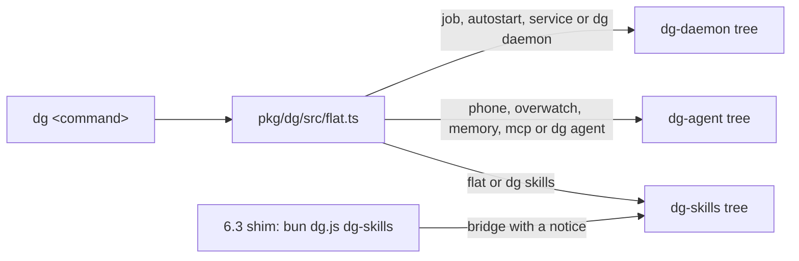

# One dg program with flat commands

Status: Accepted
Date: 2026-11-21
Topic: Platform

This record supersedes [ADR 0020](0020-one-dg-command.md) and its 2026-11-18 amendment where they disagree. It
supersedes in part [ADR 0025](0025-per-os-layout.md), [ADR 0032](0032-shared-runtime-bundle.md) and
[ADR 0049](0049-jobs.md).

## Context

- ADR 0020 chose one compiled `dg` binary. Its amendment kept four program names instead: `dg`, `dg-skills`,
  `dg-agent` and `dg-daemon`, each a launcher over one bundle. ADR 0032 made that bundle one minified `dg.js`
  (about 12 MB) run by one pinned Bun runtime (about 76 MB).
- A user has to know which program owns a command: `dg-skills pw`, `dg-agent phone`, `dg-daemon job`. `dg`
  mounted nine of them by hand, so most commands had no `dg` form.
- Skill texts call `dg-skills` about 1,500 times, `dg-agent` about 130 times and `dg-daemon` about 80 times.
- Release already uses one tag, `v<x>`. No tag bridge is left to plan.
- Stored argv names the bundle: the autostart unit and the phone listener unit run
  `<data>/runtime/current/bun <data>/lib/current/dg.js <program> ...`, and a job can name an old program by PATH.
- `bun build --compile --splitting --minify` works on Bun 1.4.2. A compiled `dg` is about 93 MB for each platform.

## Decision

- **One program.** dg ships one compiled `dg` executable for each platform, built with `bun build --compile`.
  The release has eight assets, `dg-<os>-<arch>[-baseline][.exe]`, listed in `SHA256SUMS`. The tag stays `v<x>`.
- **Flat commands.** Every `dg-skills` command, plus `dg-agent` `phone`, `overwatch`, `memory` and `mcp`, plus
  `dg-daemon` `job`, `autostart` and `service`, runs as `dg <command>`. `pkg/dg/src/flat.ts` derives the routes
  from the three generated completion trees, so a new command needs no edit in `pkg/dg`.
- **Collision rule.** Daemon lifecycle verbs stay under `dg daemon`: `serve`, `status`, `start`, `stop`,
  `restart`, `sessions` and `origin`. Agent session verbs stay under `dg agent`: `start`, `send`, `recv`,
  `progress`, `spawn`, `stage`, `close` and `manifest`. A bare `dg start` exits 1 and names both. A test fails on
  any name that two trees share and that no table owns.
- **Groups.** `dg skills`, `dg agent` and `dg daemon` stay as group mounts, so every command keeps one full path.
- **Old names are removed.** Install writes no `dg-skills`, `dg-agent` or `dg-daemon` file. It removes the old
  shims, `.cmd` files and the `~/.dg/bin` notice launchers on upgrade. There is no dispatch on the invoked name.
  A compiled `dg` started under an old name prints a notice that names the `dg` form and exits 1.
- **Layout.** The program lives at `<data>/bin/<version>/dg[.exe]`. `<data>/bin/current` points at the active
  version folder and changes by create-then-rename, as in ADR 0032. `<bin>/dg` is a symlink to
  `<data>/bin/current/dg` on Linux and macOS, and a hard link `<bin>\dg.exe` on Windows. Install keeps the
  version it replaces for rollback.
- **Stored argv.** `launcherCommand` writes `[<data>/bin/current/dg, <group>, ...]` and `rewriteLauncherArgv`
  owns the old-to-new mapping. The daemon rewrites job argv once at start, and install and `dg autostart install`
  rewrite the login units. Each rewrite is idempotent and keeps a 0600 backup. `dg daemon serve` is the
  long-running daemon.
- **6.3 bridge.** A 6.3 self-update reads `dg-lib-<v>.tar.gz` and `runtime.json`, checks
  `bun dg.js dg-skills --version`, links `lib/current`, then runs `<bin>/dg-skills install launchers`. The release
  keeps both assets for two minor releases, and the bundle keeps the `<program> ...args` form only for this
  bridge, with a notice. The hidden `install launchers` step installs the compiled program of its own version,
  rewrites stored argv and hook lines, and removes the old launchers.
- **Rollback.** `dg install --version <v>` relinks `<data>/bin/current` with no download while
  `<data>/bin/<v>` exists. A rollback to 6.3 runs the 6.3 `bootstrap.sh`.

## Consequences

- **Good:** one command to learn. `dg pw`, `dg phone` and `dg job` work, and a new command is reachable with no
  routing edit.
- **Good:** one file to install and run, with no runtime folder and no shell shim.
- **Bad:** each release adds about 740 MB of assets, and each install downloads about 93 MB in place of a 12 MB
  bundle when only dg code changed.
- **Bad:** a script outside dg-ai that calls `dg-skills`, `dg-agent` or `dg-daemon` breaks. It must move to `dg`.
- **Neutral:** for two minor releases the release also ships the bundle tarball and `runtime.json` so a 6.3
  install can update.

## Diagram

## Other options

- **Keep the ADR 0032 bundle and runtime with `dg` as the one launcher.** Smaller downloads, but two moving
  parts and shell shims on each platform.
- **Keep the old names as links to the compiled program.** Old scripts keep working, but the names never go
  away and the program has to dispatch on the invoked name.
- **Mount the three commander programs into one tree.** It loads every tree at startup and breaks the startup
  budget.
- **Hand-written flat routes.** They drift on every new command.

## References

- [ADR 0020 — One `dg` command and binary that supervises channel review](0020-one-dg-command.md)
- [ADR 0025 — Keep dg files in the per-OS layout](0025-per-os-layout.md)
- [ADR 0032 — Ship one pinned Bun runtime and one minified bundle](0032-shared-runtime-bundle.md)
- [ADR 0049 — One job model for services and scheduled jobs](0049-jobs.md)
- `pkg/dg/src/flat.ts`
- `pkg/launcher/build.ts`
- `pkg/common/src/node/program.ts`
- `.github/workflows/release.yml`
