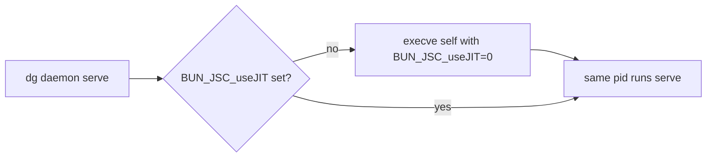

# Long-running dg processes run without the JIT

Status: Accepted
Date: 2026-11-23
Topic: Platform
Superseded in part by [ADR 0058](0058-dg-moves-to-c-nativeaot-in-stages.md) (spec 027, commit 42731b84): `dg --version` and `dg hooks run` skip the JIT re-exec.

This record is superseded in part by [ADR 0057](0057-every-dg-command-runs-without-the-jit.md).

## Context

- The goal is every dg process below 80 MB of peak RSS, and as low as it can go.
- `scripts/ram-budget.ts` measures a compiled dg in a fenced temp home. The phone listener peaked at 80 MB idle
  and 85 MB after a burst of 20 messages. The daemon peaked at 50 MB idle.
- About 35 MB of the listener and the daemon is file-backed text of the dg executable. Most of that is the JSC
  optimizing compilers (Baseline, DFG, FTL) and their heaps, which a process faults in once its code gets hot.
- JSC reads its options only from `BUN_JSC_*` environment variables, before any script runs. `bun build
  --compile` cannot bake them into the executable, and `--smol` saved nothing here.
- With `BUN_JSC_useJIT=0` the listener peaked at 56 MB and the daemon at 42 MB. DFG off alone left the listener
  at 70 to 79 MB.
- The cost is CPU. The listener spent 14.5 s instead of 2.8 s on about 90 messages, about 160 ms of CPU for each
  message. A nostr-tools sign went from 7.6 ms to 14 ms and an ECDH from 4.8 ms to 12 ms. The daemon used 0.23 s
  instead of 0.2 s of CPU for 80 requests.

## Decision

- `dispatch` re-executes `dg agent phone listen`, `dg phone listen`, `dg daemon serve` and `dg prototype serve`
  (and the bridge forms `dg dg-agent phone listen` and `dg dg-daemon serve`) once through `process.execve` with
  `BUN_JSC_useJIT=0`. `execve` keeps the pid, so pid files, service managers and claims see one process.
- When dg set `BUN_JSC_useJIT=0` itself, the re-executed process removes it from its environment at start, so the
  programs it spawns (an `--on-message` hook, a job) keep their own JIT. If `execve` throws, dg prints why and runs with the JIT.
- A `BUN_JSC_useJIT` that the caller already set is kept, so `BUN_JSC_useJIT=1` turns the JIT back on.
- Windows has no `execve`, so long-running processes there keep the JIT.
- Short commands keep the JIT. Re-executing every command costs a second runtime start on each hook call.
- The compiled-dg workflow runs `scripts/ram-budget.ts --gate` on linux-x64 with a budget for each process.

## Consequences

- The listener and the daemon stay well below 80 MB, idle and under load.
- Message crypto in the listener is about five times slower. A catch-up of hundreds of messages after a long
  offline period takes tens of seconds of CPU instead of a few.
- The policy works for login units already installed, because it lives in the program and not in the unit text.
- A new long-running command must be added to `NO_JIT` in `pkg/launcher/src/dispatch.ts` to get the same saving.

## Diagram

## Other options

- Set the variable in each spawn site and in the systemd, launchd and Task Scheduler units. That needs three unit
  formats, misses units already installed, and Task Scheduler has no environment field.
- Re-execute every dg command. Short commands lose about 7 MB, but each one pays a second runtime start.
- Turn off DFG and FTL only. That keeps more speed but saves about half as much memory.
- Move the listener to a different runtime or a native helper. That is a redesign and stays a separate decision.
