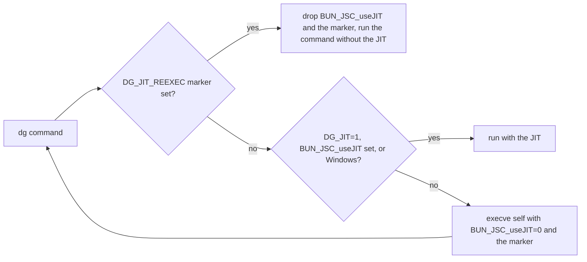

# Every dg command runs without the JIT

Status: Accepted
Date: 2026-11-24
Topic: Platform

This record supersedes in part [ADR 0056](0056-long-running-dg-processes-run-without-the-jit.md), which kept the JIT
for short commands.

## Context

- ADR 0056 turned the JSC JIT off for the phone listener, the daemon and `prototype serve` only. It left short
  commands with the JIT, because a re-exec adds a second runtime start to every hook call.
- PR #254 measured what short commands would save: 5 to 8 MB of peak RSS each, and 20 MB on `spec validate`.
- Dante chose that saving over the time cost.
- JSC reads its options only from `BUN_JSC_*` environment variables at startup. `bun build --compile` can bake
  Bun flags into `execArgv`, but Bun has no flag for JSC options, so a re-exec is the only way.
- On an idle machine, 50 runs each, the re-exec added about 5 ms to the median of `dg hooks run spelling`
  (30 to 35 ms) and 6 ms to `dg --version`. The limit set for the hook path was 15 ms of added median time.
- The same review found that `bun build --compile` loads a `.env` and runs a `bunfig.toml` preload from the
  working directory. That is a startup behavior of the same executable, so this record covers it too.

## Decision

- The dg entry (`pkg/launcher/src/dg.ts`) calls `reexecWithoutJit` before dispatch. It re-executes once through
  `process.execve` with `BUN_JSC_useJIT=0` and a `DG_JIT_REEXEC` marker. `execve` keeps the pid.
- The re-executed process removes both variables at start, so the programs it spawns keep their own JIT.
- `DG_JIT=1` skips the re-exec and keeps the JIT for a heavy one-off run. A `BUN_JSC_useJIT` the caller set is
  kept too.
- `bun:ffi` refuses to load without the JIT. dg uses it for the `flock` file lock (`jot`, `stat`) and for the
  page-cache drop after an install (`install`, `update`, `upgrade`, `extension`). Those commands keep the JIT
  (`FFI_COMMANDS` in `dispatch.ts`). A launcher test lists every module that imports `bun:ffi`, so a new one
  fails until its commands are added.
- If `execve` throws, dg prints why and runs with the JIT. Windows has no `execve` and keeps the JIT.
- `dispatch()` itself never re-executes, so code that imports it, such as tests, keeps its own process.
- The compiled dg loads no `.env` and no `bunfig.toml` from the working directory.
- `scripts/ram-budget.ts --gate` checks peak RSS for each case and the median wall time of each `dg hooks run`
  case over 50 runs. The 15 ms limit above is the design limit on the added cost; the CI gate checks the total
  median against `HOOK_MS` in `scripts/ram-budget.ts`: 52 ms, the CI runner's 43 ms plus 20 percent.

## Consequences

- Every dg process is smaller. The saving grows with the code a command runs: about 3 MB for a hook, about 8 MB
  for a phone or config command, and 8 to 17 MB for `spec validate` and `adr lint`.
- Every command pays a second runtime start, about 5 ms.
- CPU-heavy commands run slower. In the 3-run median of the RAM harness, `adr lint --all` on this repo went from
  76 to 184 ms. `DG_JIT=1` is the way out for a heavy run.
- A repo's `.env` or `bunfig.toml` can no longer change dg's environment or run code inside it.

## Diagram

## Other options

- Replace the `flock` lock with the rename lock dg uses on Windows, so no command needs `bun:ffi`. Two lock kinds
  on one file would not exclude each other during an upgrade, so this stays a separate change.

- Keep the JIT for short commands (ADR 0056). That keeps each one 5 to 8 MB larger.
- Skip the re-exec for `dg hooks run` only. The measured cost was about 5 ms, under the 15 ms limit set for that
  path, so the hot path gets the same rule as everything else.
- Bake the option into the executable. Bun has no compile flag for JSC options.
