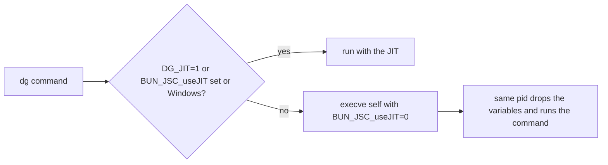

# Every dg command runs without the JIT

Status: Accepted
Date: 2026-11-24
Topic: Platform

This record supersedes in part [ADR 0056](0056-long-running-dg-processes-run-without-the-jit.md), which kept the JIT
for short commands.

## Context

- ADR 0056 turned the JSC JIT off for the phone listener, the daemon and `prototype serve` only. It left short
  commands with the JIT, because a re-exec adds a second runtime start to every hook call.
- PR #254 measured what short commands would save: 5 to 8 MB of peak RSS each, and 20 MB on `spec validate`.
- Dante chose that saving over the time cost.
- JSC reads its options only from `BUN_JSC_*` environment variables at startup. `bun build --compile` can bake
  Bun flags into `execArgv`, but Bun has no flag for JSC options, so a re-exec is the only way.
- On an idle machine, 50 runs each, the re-exec added about 5 ms to the median of `dg hooks run spelling`
  (30 to 35 ms) and 6 ms to `dg --version`.

## Decision

- The dg entry (`pkg/launcher/src/dg.ts`) calls `reexecWithoutJit` before dispatch. It re-executes once through
  `process.execve` with `BUN_JSC_useJIT=0` and a `DG_JIT_REEXEC` marker. `execve` keeps the pid.
- The re-executed process removes both variables at start, so the programs it spawns keep their own JIT.
- `DG_JIT=1` skips the re-exec and keeps the JIT for a heavy one-off run. A `BUN_JSC_useJIT` the caller set is
  kept too.
- If `execve` throws, dg prints why and runs with the JIT. Windows has no `execve` and keeps the JIT.
- `dispatch()` itself never re-executes, so code that imports it, such as tests, keeps its own process.
- The compiled dg loads no `.env` and no `bunfig.toml` from the working directory.
- `scripts/ram-budget.ts --gate` checks both peak RSS and the median wall time of the hook path in CI.

## Consequences

- Every dg process is smaller: hooks by about 2 MB, phone commands by about 8 MB, spec and adr commands by more.
- Every command pays a second runtime start, about 5 ms.
- CPU-heavy commands run slower. `adr lint --all` took about twice as long in a direct test. `DG_JIT=1` is the
  way out for a heavy run.
- A repo's `.env` or `bunfig.toml` can no longer change dg's environment or run code inside it.

## Diagram

## Other options

- Keep the JIT for short commands (ADR 0056). That keeps each one 5 to 8 MB larger.
- Skip the re-exec for `dg hooks run` only. The measured cost was about 5 ms, under the 15 ms limit set for that
  path, so the hot path gets the same rule as everything else.
- Bake the option into the executable. Bun has no compile flag for JSC options.
