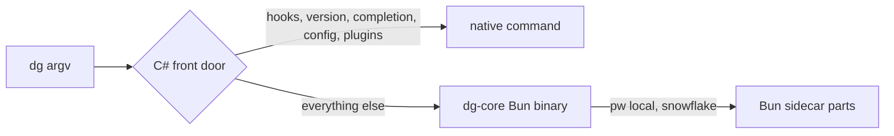

# dg moves to C# NativeAOT in stages

Status: Accepted (stage 1 implemented; stages 2 and 3 not yet; plan in `.agents/spec/027_dg_cli_lean/plan.md`)
Date: 2026-11-24
Topic: Platform

This record builds on [ADR 0055](0055-one-dg-program-with-flat-commands.md) (one dg program with flat commands),
[ADR 0056](0056-long-running-dg-processes-run-without-the-jit.md) and
[ADR 0057](0057-every-dg-command-runs-without-the-jit.md) (the JIT is off to cut RSS). The staged port replaces the
JIT workaround for every command it moves.

## Context

- dg 7.0.5 is one `bun build --compile` binary of about 93 MB per target. The Bun runtime floor is 81 MB; dg's bundle
  is 11.3 MB, of which playwright-core is 4.1 MB and the Snowflake and MSAL cluster about 3.5 MB.
- `dg hooks run` runs on every agent tool call: 33.8 ms p50 and 29.5 MB peak RSS on the reference machine. The JIT
  re-exec adds 5 ms, the full route tree about 11 ms, and node streams about 5 ms.
- A C# NativeAOT hook prototype on .NET 11 (Utf8JsonReader, [GeneratedRegex], FrozenDictionary, a DI container)
  measured 1.8 ms p50, 5.0 MB peak RSS and 2.3 MB on disk. The DI container build cost 0.1 ms.
- An AOT probe found Snowflake.Data 6.5.0 not AOT-safe (74 warnings plus its dependencies). Npgsql, MSAL.NET,
  Markdig, Microsoft.Data.Sqlite and NBitcoin.Secp256k1 were clean. Microsoft.Playwright runs a Node driver.
- NativeAOT does not cross-compile across operating systems, so the C# binaries need Linux, Windows and macOS
  runners. macOS stays a release target.

## Decision

- dg moves to C# NativeAOT (net11.0, SDK pinned in `native/global.json`) in stages. Each stage ships behind a parity
  suite that runs the same fixtures through the Bun dg and the C# binary.
- Stage 1 is a C# front door. It runs every hook id, `--version`, completion, config, routing and the plugin
  commands natively, and execs the Bun binary (`dg-core`) for every other command. It is on by default; `DG_FRONT=0` or
  `front.enabled = false` opts out, and a missing or failing native binary falls back to the Bun dg.
- Stage 2 moves the phone listener and the daemon (HttpListener, not Kestrel). Stage 3 moves the command groups by
  use and size. At the final switch, the Bun binary becomes a sidecar that downloads on first use.
- pw local (Playwright), Snowflake, verify capture and demo recording stay in the Bun sidecar until the end.
- The browser extension stays TypeScript, built and tested with Bun. C# talks to it only through the written relay
  contract. Bun stays a permanent dev toolchain.
- config.toml (ADR 0054) stays the only user config for both runtimes, with the same validation and error text.
- The solution has one project per command group plus a shared Dg.Core. Groups register through `AddX()`
  extensions on IServiceCollection, explicitly and without scanning. Reflection is not allowed; source generators
  only.
- RSS, size, download, latency and skill-token budgets are gated on every PR with a ratchet that only goes down,
  unless a PR carries a reviewed `Budget-Increase:` line. Latency and memory-growth budgets are ceilings that fail
  only on an overrun (owner decision R18, 2026-11-25; see "Agent Notes" in
  `.agents/spec/027_dg_cli_lean/plan.md` and the "Ratchet" section of `docs/lean-baseline.md`).

## Consequences

- Hook latency drops from 33.8 ms to about 2-3 ms and hook RSS from 29.5 MB to about 5 MB once stage 1 is on.
- During the transition two binaries ship and update together; install and self-update handle both.
- Each release adds about 30-50 runner minutes for 6 NativeAOT jobs.
- The download shrinks only at the final switch; until then every user still downloads the Bun core.
- The repo needs both the .NET SDK and Bun to build.

## Diagram

## Other options

- Stay on Bun and trim only: hooks stay at 12-20 ms and RSS stays at 20-55 MB.
- A Rust port: smaller binaries, but no persona and more glue for MSAL; C# has MSAL.NET and Npgsql AOT-safe.
- A full port at once: 12-18 engineer-months with no Snowflake or Playwright path.
