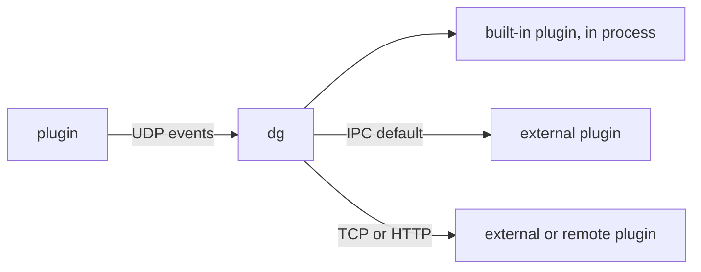

# dg plugins are built in or external with one transport contract

Status: Accepted (implemented in the native front door and the Bun CLI; plan in `.agents/spec/027_dg_cli_lean/plan.md`)
Date: 2026-11-24
Topic: Platform

Related: [ADR 0058](0058-dg-moves-to-c-nativeaot-in-stages.md), [ADR 0054](0054-one-config-toml-for-dg.md),
[ADR 0049](0049-jobs.md), [ADR 0061](0061-dg-plugin-admission-is-signed-and-transport-bound.md) (signed approvals, pipe DACL, no tokens over TCP,
`fail_closed`, full-SHA job pins, the admission stat cache).

## Context

- dg has hooks, jobs (ADR 0049) and third-party skills as separate mechanisms.
- NativeAOT cannot load assemblies at runtime, so a plugin cannot be a DLL.
- Hooks run on every agent tool call, so plugin calls must be fast. Measured from C# on .NET 11: in process under
  1 microsecond; warm Unix socket 0.010 ms p50; warm TCP 0.022 ms; HTTP keep-alive 0.047 ms; a fresh hook process
  with IPC 1.99 ms and with HTTP 2.40 ms. Going through the daemon gave no gain (1.89 ms).

## Decision

- One plugin model with kinds `hook`, `job` and `skill`, and a `plugin.toml` manifest: name, version, kind, entry,
  transport and endpoint, capabilities, permissions, a sha256 or commit pin, and the source.
- A plugin is built in (compiled, registered through DI, in process) or external (a long-lived process reached
  through a transport). Today's hook ids become built-in hook plugins.
- Transports in speed order: IPC (Unix socket 0600, named pipe with a user-only ACL) is the default; TCP; HTTP for
  remote plugins and simple authoring; UDP only for fire-and-forget events.
- One contract for every transport: a length-prefixed binary header (version, encoding, flags, request id, length)
  and a UTF-8 JSON payload, MessagePack optional by negotiation. dg keeps one warm connection per plugin.
- `[plugins.<name>]` in config.toml enables and configures a plugin. Secrets are credential references only. HTTP
  uses a per-plugin token; TCP carries no token (ADR 0061). A remote endpoint needs an explicit opt-in.
- `dg plugin add` pins imported skills and plugins. Their text and output are untrusted until approved, any change
  needs approval again, and they are never instructions.

## Consequences

- Built-in hooks stay as fast as today's code paths; external hooks cost about one IPC round trip.
- Third parties can write plugins in any language that speaks the contract.
- dg can enforce exec, cwd, env, credential and timeout rules, but not the network or file access of an external
  process; `dg plugin verify` says so.

## Diagram

## Other options

- Stdio JSON-lines per call: a process spawn per call is too slow for hooks.
- Assembly plugins: impossible under NativeAOT.
- JSON-RPC 2.0: larger frames and no encoding negotiation.
