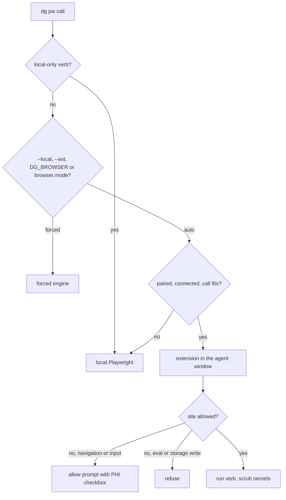

# dg pw picks its browser per call, and the extension gains 24 verbs behind new safety rules

Status: Accepted (implemented in spec `027_dg_cli_lean`)
Date: 2026-11-25
Topic: Skills

Related: [ADR 0035](0035-pw-ext-real-browser.md), [ADR 0058](0058-dg-moves-to-c-nativeaot-in-stages.md),
[ADR 0028](0028-local-default-extension-opt-in.md), [ADR 0045](0045-pw-ext-driving-banner-and-sites.md),
[ADR 0054](0054-one-config-toml-for-dg.md).

## Context

- ADR 0028 made every skill local and the extension opt-in with `--ext`. ADR 0035 said a new ext verb needs its own
  record. Since then, a person who has the extension paired still types `--ext` on every call.
- The extension covered open, click, fill, press, reads and tab control. It lacked history moves, pointer verbs,
  checkboxes, typing, `eval`, `resize` and storage writes, so an agent fell back to Playwright for common steps.
- Driving the real profile by default needs more safety than a banner and a per-session allowlist. A new site must
  ask first, a site with protected health information must not leak through a capture, and a write that skips the
  question must be refused.
- The C# front door (ADR 0058) ports commands in stages. The extension and its verbs stay TypeScript and Bun.

## Decision

- Add `auto` as the default browser mode. The order is: a local-only verb runs local; `--local` or `--ext`; then
  `DG_BROWSER=ext|local`; then `browser.mode` in `config.toml` (`ext`, `local`, `auto`); then auto.
- Auto sends a call to the extension only when the extension is paired and connected, the verb has an ext verb, the
  call has no options and no session, and the positional count fits. Otherwise the call runs local with no error.
  The pw name maps to the ext name: `goto` to `open`, `tab-list` to `tabs`, `tab-new` to `new`, `tab-close` to
  `close`.
- `select`, `close`, `tab-select`, `upload` and `tab-close <index>` stay local in auto mode. Their pw meaning
  differs from the ext verb of the same name.
- These verbs are local-only in every mode, because they need the Playwright engine or would copy the sign-ins of the
  real profile: `route`, `unroute`, `route-list`, `network-state-set`, `state-save`, `state-load`, `delete-data`,
  `cookie-set`, `cookie-delete`, `cookie-clear`, `video-start`, `video-stop`, `video-chapter`, `tracing-start`,
  `tracing-stop`, `pdf`, `install-browser`, `kill-all` and `attach`. `--ext` with one of them exits 2.
- Add 24 ext verb modules, in five files under `pkg/extension/lib/background/pw-verbs/` and `pkg/skills-cli/src/pw/ext-verbs/`:
  - navigation: `go-back`, `go-forward`, `reload`
  - pointer: `hover`, `dblclick`, `drag`, `mousedown`, `mouseup`, `mousemove`, `mousewheel`
  - input: `check`, `uncheck`, `type`, `keydown`, `keyup`
  - page: `eval`, `tab-select`, `resize`
  - storage: `localstorage-set`, `localstorage-delete`, `localstorage-clear`, `sessionstorage-set`,
    `sessionstorage-delete`, `sessionstorage-clear`
- Safety rules, which hold for every ext call:
  - Each dg session gets its own agent window: separate, unfocused and not private.
  - The first visit to each new site asks the person to allow it for the session. Navigation, pointer and input
    verbs ask first.
  - The prompt has a PHI checkbox. A flagged site refuses `snapshot` and `screenshot` for the session. The check runs
    after the prompt, because the answer sets the flag.
  - `eval` and the storage writes never open the prompt. They refuse a site that is not allowed.
  - Cookie writes and state files stay local-only.
  - Every result passes the same secret scrub as the existing verbs.

## Consequences

- A person with the extension paired gets the real browser with no flag. A person without it sees no change.
- A call with an option or a session silently runs local in auto mode. `--ext` is the way to force the extension and
  get an error when the call does not fit.
- `DG_BROWSER` now means two things: a mode for `dg pw` and a browser binary path for the `demo` and `verify`
  finders. A path in `DG_BROWSER` makes `dg pw` stop with an error. Use `DG_VERIFY_BROWSER` for the path.
- CI, recorded fixtures and the extension's own tests use `--local`, so they do not depend on a paired extension.
- Each new verb adds wire surface. The shared validators in `pkg/common/src/pw-ext-verbs/` bound every argument.

## Diagram

## Other options

- Keep `--ext` as the only way in: agents keep falling back to Playwright for common steps.
- Route every verb to the extension in auto mode: `select`, `close` and `upload` change meaning, and options such as
  `--headless` have no extension equivalent.
- Allow cookie and state verbs in the real profile: they copy sign-ins outside the credential store.
- Prompt for `eval` and storage writes: a write that pops a prompt in the middle of a script is easy to approve by
  habit, so the person decides on the navigation that comes first.

## Update 2026-11-25

`DG_BROWSER` now means the browser executable path only. The pw mode moved to `DG_PW_MODE` and to `[pw] mode` in
`config.toml`, which replaces `[browser] mode`. The order of choice is a flag, then `DG_PW_MODE`, then `[pw] mode`,
then `auto`. A mode word in `DG_BROWSER` stops the command with an error that names `DG_PW_MODE`, and a config that
still sets `browser.mode` fails validation with an error that names `pw.mode`. `[pw] phi_sites` adds a persistent
PHI site list beside the per-session checkbox. The decision above is otherwise unchanged.
