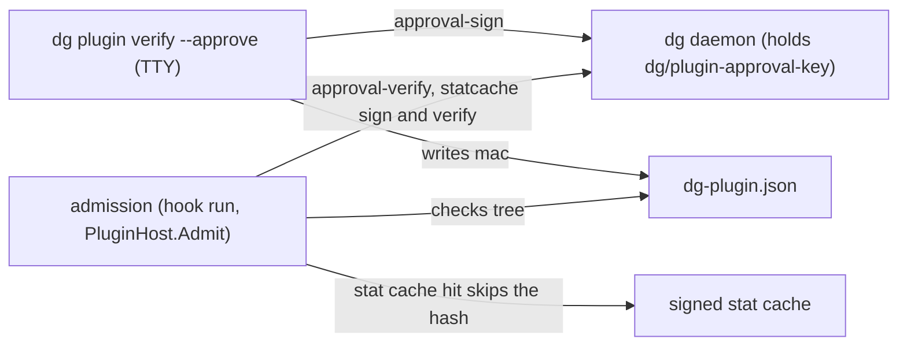

# dg plugin admission is signed, and plugin tokens stay off plain TCP

Status: Accepted (implemented in the daemon, the Bun CLI and the native plugin runtime; follow-up to spec 027)
Date: 2026-11-25
Topic: Security

Related: [ADR 0059](0059-dg-plugins-are-built-in-or-external-with-one-transport-contract.md),
[ADR 0006](0006-credential-store.md), [ADR 0049](0049-jobs.md).

## Context

- ADR 0059 admits a plugin when `dg-plugin.json` says it is approved and the tree hash matches. Any process that
  can write the plugin folder can also write that record, so an agent could approve a plugin by editing a file.
- The Windows named pipe used a user-only ACL but did not refuse network logons.
- TCP plugins sent their token in a plain-text hello. Loopback TCP is readable by any local process that can sniff
  or proxy the port.
- A crash or a timeout of an external hook plugin always let the action go ahead.
- Job plugins could be pinned by a tag, a branch or a short commit, which can move.
- `PluginHost.Admit` hashed the whole plugin tree on every call.

## Decision

1. **Signed approvals.** The approval record carries `mac`, an HMAC-SHA256 over the record fields (name, kind,
   source, pin, tree hash, approved hash) with a domain prefix. The dg daemon signs and verifies. The key is the dg
   credential `dg/plugin-approval-key` in the daemon credential store, and it never leaves the daemon. The CLI and
   the plugin host send the fields to the daemon over the authenticated session channel (`approval-sign`,
   `approval-verify`) and get the MAC or a boolean back. The daemon creates the key on first sign and refuses
   `get`, `set`, `intake` and `exec` of that name; `list` shows the name and no value. Prefix grants and the extension
   cannot sign or verify, and the prefix `dg` is reserved. An unsigned record or a bad MAC fails admission, and so
   does a record whose signed fields hold a NUL byte. Only `dg plugin verify <name> --approve` asks the daemon to
   sign an approval, and it keeps the stdin TTY gate. Without a running daemon or a registered session, no plugin is
   approved.
2. **Pipe DACL.** The Windows named pipe allows the current user SID only and denies the network logon SID.
3. **No tokens over TCP.** A plugin that needs a token must use IPC or HTTPS. dg refuses a TCP plugin with a token
   at manifest validation and never sends a token over TCP. TCP stays for plugins without authentication.
4. **`fail_closed`.** `[plugins.<name>] fail_closed = true` makes a crash or a timeout of that hook plugin block
   the action. The default stays `false`.
5. **Job pins.** A job plugin pin is a full commit SHA (40 or 64 hex). dg checks the commit and the tree hash at
   install and again at load, and refuses tags, branches and short SHAs. It also refuses a clone with uncommitted
   or untracked files that are not ignored, index entries marked assume-unchanged or skip-worktree, and local
   `.git/info/exclude` rules.
6. **Admission stat cache.** `PluginHost.Admit` keeps a stat cache per plugin: size, mtime in nanoseconds and file
   identity (inode, or the Windows file index) for each file in the plugin tree, the attested tree hash and the
   time of the last full hash, in `stat-cache.json` in the plugin folder. Times are nanoseconds since the Unix epoch. The daemon signs the cache with the same key for a separate purpose (`statcache`, its own domain prefix), over the tree hash, the time of the last full hash and a digest of the stamps. dg hashes the tree again when any stat
   changes, when the signature fails, when the attested hash differs from the record, and fully once a day.

## Consequences

- Editing `dg-plugin.json` no longer approves a plugin. The key never reaches the CLI, the plugin host or an agent,
  so no process can forge a MAC offline. Any active session can still ask the daemon to sign: the TTY gate lives in
  the CLI, not in the daemon. An agent that can run code as the user and reach a session can still get a record
  signed, so the gate and the daemon raise the cost, they do not remove it.
- Deleting the key credential (`dg credentials delete dg/plugin-approval-key`) rotates it. Every approval then fails
  until the user approves again.
- The native plugin runtime asks an `IApprovalSigner` and never sees the key. No daemon client implements it yet, and
  the front-door binary does not include the runtime, so tests use a fake signer.
- Each admission costs one daemon round trip for the approval and one for the stat cache.
- Records written before this change are unsigned. Users approve each plugin again once.
- External hook plugins need a running dg daemon and a registered session to be admitted. A plugin that fails
  admission never blocks the tool call, even with `fail_closed = true`. The C# front door has no credential client, so
  native `dg plugin list`, `verify` and `enable` hand a record that claims approval to the Bun program.
- Most admissions skip the tree hash; a daily full hash bounds how long a stat-preserving edit can last.

## Diagram

## Other options

- A key file next to the record: any writer of the folder could also write the key.
- Reading the key into the CLI and the plugin host and signing there: the first version of this ADR. Any process that
  could reach a session could read the key and forge a record. The daemon-side option replaced it.
- Refusing tokens over plain `http://` loopback too: out of scope here; HTTP stays for simple authoring.
