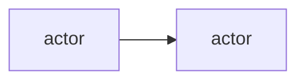

# NNNN — Title

Status: Proposed
Date: YYYY-MM-DD

## Context

- State the force or constraint that makes a decision necessary.
- Use three to six bullets.
- Name the failure that the decision prevents.

## Decision

State the decision in one paragraph. Use the present tense. Name the actors and
the code paths that carry the decision.

## Consequences

- **Good:** what the decision gives you, with a code path.
- **Bad:** what it costs, with a code path.
- **Neutral:** what changes without a clear gain or loss.

## Alternatives considered

- **Option.** Why the project did not choose it.

## Diagrams

## References

- `pkg/<package>/src/<file>.ts`
