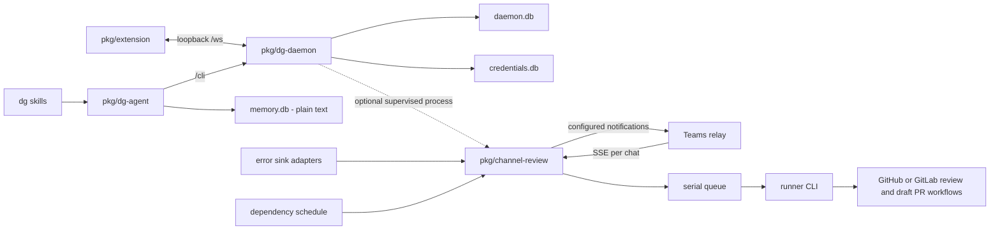

# Architecture decision records

These records describe the implementation on master as inspected on 2026-10-16
through commit `5d0311b`. Dates record this documentation pass, not the date
of the original design. The sixteen historical records below are Accepted, alongside the existing skills-only installation record.

## How the pieces fit

## Installation

- [0001 — Skills-only installation](0001-skills-only-install.md)

## Platform

- [0002 — The daemon owns durable sessions and work](0002-daemon-hub.md)
- [0003 — SQLite for daemon state; JSON for channel review](0003-storage-by-writer.md)

## Security

- [0004 — Require origin and capability checks on loopback](0004-loopback-pairing.md)
- [0005 — Encrypt secret fields with a wrapped data key](0005-field-encryption.md)
- [0006 — Separate credential storage and prefix-scoped service grants](0006-credential-store.md)
- [0007 — Keep deployment values out of the public repository](0007-private-configuration.md)

## Channel review

- [0008 — Consume one resumable relay stream per chat](0008-relay-streams.md)
- [0009 — Serialize runner jobs across chats and task kinds](0009-serial-work.md)
- [0010 — Use an owner token and sender IDs for write-capable chat commands](0010-sender-gates.md)
- [0011 — Parse commands only from the sender’s own text](0011-sender-text.md)
- [0012 — Invoke runner CLIs with task-specific tool lists](0012-runner-boundaries.md)

## Automation

- [0013 — Pass error reports as data files](0013-untrusted-reports.md)
- [0014 — Automation opens drafts and never merges them](0014-draft-prs.md)
- [0015 — Normalize error providers behind a polling interface](0015-error-sinks.md)
- [0016 — Run dependency work in bounded windows with a cooldown](0016-scheduled-dependencies.md)
- [0017 — Isolate automation clones and guard recursive deletion](0017-clone-lifecycle.md)

## Proposed changes

- [0018 — Store channel-review state in the shared daemon database](0018-channel-review-state-in-daemon-db.md)
- [0019 — Pass review origin and model evidence across runner attempts](0019-review-execution-context.md)
- [0020 — One `dg` command and binary that supervises channel review](0020-one-dg-command.md)
- [0021 — Relay `--ext` scrape and plant through the daemon instead of Downloads](0021-proto-daemon-relay.md)
- [0022 — Keep Proton filters in one declared file](0022-proton-filter-policy.md)

## Adding an ADR

Use [the template](template.md). Store each record in `docs/adr/NNNN-kebab-title.md`.
Choose the next free four-digit number and never reuse a number. Add its link here.

Write a record when a skill adds a wire contract, frame type, store, table, state
file, trust boundary, secret path, process that writes outside `DG_HOME` or
pushes remotely, or a wider gate or allowlist. Flags, reaction choices, copy
changes, and bug fixes do not each need a record unless they change such a boundary.

- **Proposed:** the implementation is not yet on master.
- **Accepted:** the implementation is on master.
- **Deprecated:** removed without a replacement.
- **Superseded by NNNN:** replaced by a linked record.

Keep an Accepted Decision intact. To replace it, write a new record, link the
old record from its Context, and change the old Status to a linked
`Superseded by NNNN`. Correct factual errors and stale references explicitly;
do not silently recast an old decision as a different design.

Use repository-relative links to source evidence and a Mermaid flowchart or
sequence diagram. Use package names for software participants and label external
systems clearly. Keep deployment values and private machine inventories out of
this public repository. These records cover dg; machine-wide skill decisions
belong with their owning private tooling repository.
