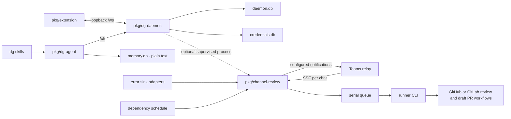

# Architecture decision records

These records describe the implementation on master as inspected on 2026-10-16
through commit `5d0311b`. Dates record this documentation pass, not the date
of the original design. The sixteen historical records below are Accepted, alongside the existing skills-only installation record.

## How the pieces fit

## Installation

- [0001 — Skills-only installation](0001-skills-only-install.md)
- [0032 — Ship one pinned Bun runtime and one minified bundle](0032-shared-runtime-bundle.md) — Accepted:
  three shims run one runtime and one code-split bundle in place of three compiled binaries.
- [0025 — Keep dg files in the per-OS layout](0025-per-os-layout.md) — Accepted:
  dg files live in the per-OS roots that `resolveDgPaths` returns, and install moves the old `~/.dg` into them.

## Platform

- [0002 — The daemon owns durable sessions and work](0002-daemon-hub.md)
- [0003 — SQLite for daemon state; JSON for channel review](0003-storage-by-writer.md)

## Security

- [0004 — Require origin and capability checks on loopback](0004-loopback-pairing.md)
- [0005 — Encrypt secret fields with a wrapped data key](0005-field-encryption.md)
- [0006 — Separate credential storage and prefix-scoped service grants](0006-credential-store.md)
- [0007 — Keep deployment values out of the public repository](0007-private-configuration.md)

## Channel review

- [0008 — Consume one resumable relay stream per chat](0008-relay-streams.md)
- [0009 — Serialize runner jobs across chats and task kinds](0009-serial-work.md)
- [0010 — Use an owner token and sender IDs for write-capable chat commands](0010-sender-gates.md)
- [0011 — Parse commands only from the sender’s own text](0011-sender-text.md)
- [0012 — Invoke runner CLIs with task-specific tool lists](0012-runner-boundaries.md)

## Automation

- [0013 — Pass error reports as data files](0013-untrusted-reports.md)
- [0014 — Automation opens drafts and never merges them](0014-draft-prs.md)
- [0015 — Normalize error providers behind a polling interface](0015-error-sinks.md)
- [0016 — Run dependency work in bounded windows with a cooldown](0016-scheduled-dependencies.md)
- [0017 — Isolate automation clones and guard recursive deletion](0017-clone-lifecycle.md)

## Proposed changes

- [0018 — Store channel-review state in the shared daemon database](0018-channel-review-state-in-daemon-db.md)
- [0019 — Pass review origin and model evidence across runner attempts](0019-review-execution-context.md)
- [0020 — One `dg` command and binary that supervises channel review](0020-one-dg-command.md)
- [0021 — Relay `--ext` scrape and plant through the daemon instead of Downloads](0021-proto-daemon-relay.md)
- [0022 — Keep Proton filters in one declared file](0022-proton-filter-policy.md)
- [0023 — Review finished work on a local page with a claimed verdict](0023-verify-local-review.md)
- [0024 — Host SMS provider commands on dg-skills](0024-ssms-on-dg-skills.md)
- [0026 — Opt-in hooks that write tool settings](0026-opt-in-hooks.md)
- [0027 — Offer pinned third-party plugins as an opt-in install](0027-optional-third-party-plugins.md)
- [0033 — Gate verify on the layout of the accepted prototype](0033-accepted-prototype-layout-gate.md)
- [0034 — Send images over the phone](0034-phone-image-messages.md) — Proposed:
  kind 15 behind a default-off `files` setting; the receiver pulls the ciphertext over Magic Wormhole with a kind 25015 request.
- [0036 — Move the legacy `~/.dg` through one layout module](0036-one-layout-module.md) — Proposed:
  one `ensureLayout` at every program start moves the legacy home, and a manual rollback replaces the rollback command.

## Skills

- [0028 — Run every skill locally and make the extension opt-in with `--ext`](0028-local-default-extension-opt-in.md) — Accepted: skills run locally unless
  the caller passes `--ext`, and a repo test enforces it. The `PENDING_LOCAL_MODE`
  allowlist (`chat`, `overwatch`) is gone: ADR 0031 ends it.
- [0029 — Accept the WSL remote-debugging port for the local demo player](0029-local-demo-player-wsl-debug-port.md) — Accepted:
  a default local `demo` on WSL opens an unauthenticated 127.0.0.1 debug port for the run.
- [0030 — Share the tour UI and play demos in a local player](0030-shared-tour-ui-and-local-player.md) — Accepted:
  the tour UI lives in `pkg/tour-ui` behind `TourHost`, and a Playwright-injected player hosts it for the local default. Superseded in part by ADR 0040.
- [0031 — Serve the chat and board pages from the daemon on loopback](0031-loopback-pages.md) — Accepted:
  `dg-daemon` serves `/chat` and `/board` behind a token and loopback-origin gate; the extension is the `--ext` path.
- [0035 — Drive the real browser with `pw --ext` behind a per-call approval](0035-pw-ext-real-browser.md) — Proposed:
  fixed verbs over the daemon relay; an extension popup asks for every call, and the CLI cannot approve. Amended 2026-11-05: passing `--ext` is the grant and the popup is gone.
- [0037 — One browser relay for inbox, proto and pw-ext](0037-one-browser-relay.md) — Proposed:
  one table-driven relay in the daemon and one dispatcher in the extension carry inbox, proto and pw-ext; frames stay byte-identical
- [0038 — Reduce the extension to pairing and tab control](0038-extension-pairing-only.md) — Proposed:
  the extension keeps a pairing popup and per-agent tab groups; offer and claim pairing replaces `POST /pair`; the daemon `/chat` page replaces the extension chat
- [0039 — Pair the browser with no code and no human step](0039-zero-touch-pairing.md) — Proposed:
  the extension keeps a link socket and adopts every session the daemon pushes; code pairing and token URLs are gone
- [0040 — Record local demos with a Node recorder](0040-local-demo-recorder.md) — Accepted:
  local `demo` always records an MP4 with a Node recorder; `$NAME` credentials, a setup handoff, and one browser finder; the start screen is gone.

- [0041 — pw --ext: user-approved, time-boxed unmask](0041-pw-ext-unmask.md) — Accepted:
  `pw --ext unmask` lets the human allow real email addresses and secret `fill` on one origin for 1 to 60 minutes; only a click in an extension-owned window grants. Amends 0035.

- [0042 — thrash: review from a scratch checkout of the PR head](0042-thrash-review-checkout.md) — Accepted:
  `thrash diff` builds a hardened scratch tree of the PR head (cwd, clone, api, none) and `thrash post` deletes it; a stack shares one clone.

- [0044 — pw --ext: answer page dialogs with a shim in agent tabs](0044-pw-ext-dialogs.md) — Accepted:
  a MAIN-world shim in agent tabs answers `alert`, `confirm` and `prompt` at once from a one-shot policy that `pw --ext dialog` sets; no new permission. Amends 0035.

## Adding an ADR

Use [the template](template.md). Store each record in `docs/adr/NNNN-kebab-title.md`.
Choose the next free four-digit number and never reuse a number. Add its link here.

Write a record when a skill adds a wire contract, frame type, store, table, state
file, trust boundary, secret path, process that writes outside `DG_HOME` or
pushes remotely, or a wider gate or allowlist. Flags, reaction choices, copy
changes, and bug fixes do not each need a record unless they change such a boundary.

- **Proposed:** the implementation is not yet on master.
- **Accepted:** the implementation is on master.
- **Deprecated:** removed without a replacement.
- **Superseded by NNNN:** replaced by a linked record.

Keep an Accepted Decision intact. To replace it, write a new record, link the
old record from its Context, and change the old Status to a linked
`Superseded by NNNN`. Correct factual errors and stale references explicitly;
do not silently recast an old decision as a different design.

Use repository-relative links to source evidence and a Mermaid flowchart or
sequence diagram. Use package names for software participants and label external
systems clearly. Keep deployment values and private machine inventories out of
this public repository. These records cover dg; machine-wide skill decisions
belong with their owning private tooling repository.
