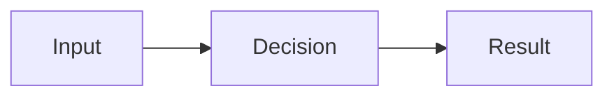

# Write the ADR

`dg-skills adr new` creates `docs/adr/NNNN-slug.md` from the template below. Fill every section. Do not change a heading: `dg-skills adr lint` checks them.

## Rules

- Plain English. Short sentences. Active voice. Name the actor.
- Write for the reader level. See [levels.md](levels.md). Lint grades the prose against the limit.
- Keep the header lines: `Status:`, `Date:`, `Topic:`, and `Level:` only when this ADR overrides the repo level.
- State the decision in the first sentence of `## Decision`.
- Draw one Mermaid diagram that explains the idea. Show the mechanism, not a list of files.
- Link files and other ADRs with relative paths. Lint checks that each link resolves.
- Never paste history. Say what holds now.

## Template

````markdown
# <title>

Status: Accepted
Date: <YYYY-MM-DD>
Topic: <topic>

## Context

Why this decision was needed.

## Decision

What we chose.

## Consequences

What gets easier and what gets harder.

## Diagram



## Other options

What we did not choose, and why.
````

Next: [write-decision.md](write-decision.md).
